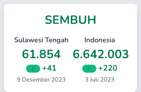
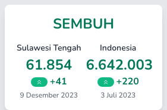
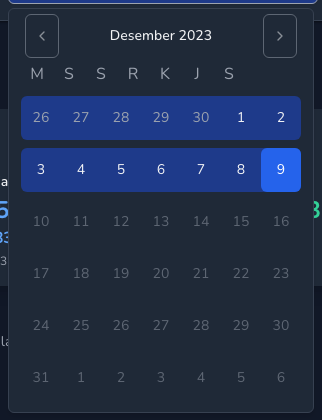
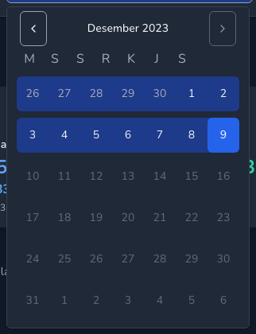
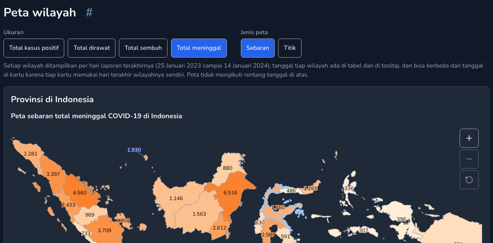
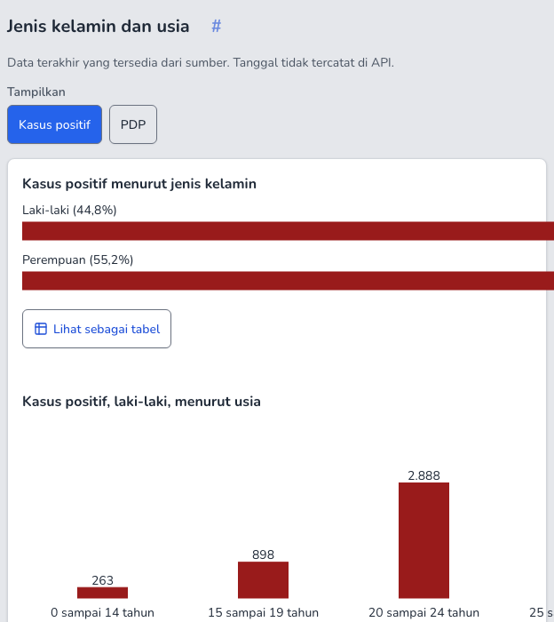
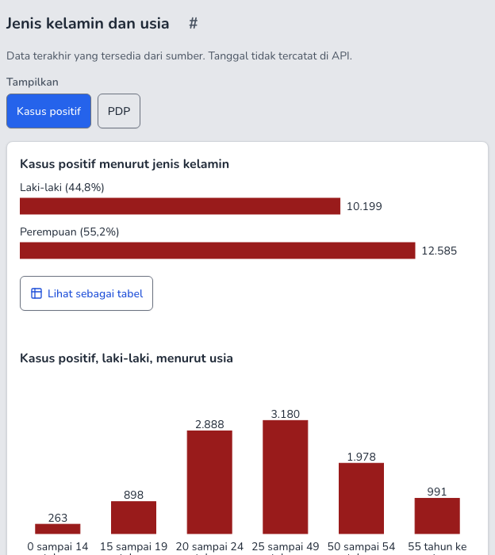

# Contrast and accessibility audit (October 2026, v6.2.1)

An independent pass over every route of pico.banuacoder.com in light and dark at 1280 and 360 px: every text and graphic pair, the states a
static scan misses (hover, focus, tooltips, every map metric, open popups), colour-blind separation, forced colours, reduced motion, reflow
and touch targets. The owner's legacy design stays: the case cards, vaccine cards, choropleth maps and the four category colours
(Positif `#991b1b`, Dirawat `#2563eb`, Sembuh `#10b981`, Meninggal `#f97316`). Where a legacy colour fails, the legacy hex stays on fills
and marks and text uses the nearest passing step; each such pair is listed below.

## Result

| | Before (origin/master `a268f2e`) | After (this branch) |
|---|---|---|
| Pairs checked (52 runs: 13 routes x 2 themes x 2 widths, all states) | 94,294 | 94,403 |
| Failing pair instances | **2,834** (131 distinct pairs) | **0** |
| of which text (static, hover, popups, map) | 692 | 0 |
| of which focus indicators | 60 | 0 |
| of which icons and UI graphics | 237 | 0 |
| of which data graphics (fills, lines, marks, gridlines) | 1,845 | 0 failing; 51 distinct pairs kept on purpose, each declared in the code (see "Kept on purpose") |
| axe-core WCAG 2.2 AA violations | 0 | 0 |
| axe colour-contrast without the animation wait | 2 nodes (transient, see below) | 0 |
| Horizontal scroll after zoom to 200 % / 400 % (640 / 320 px) | 479 / 799 px on 2 routes | 0 |
| Non-inline targets under 24 px | 2 links + 21 province map areas | 21 province map areas (see "Not fixed") |
| Dark mode, smallest colour-blind distance of the case colours | 2.3 | 6.8 |

axe found none of these: it does not check SVG text, SVG graphics or text on SVG shapes, skips text with `aria-hidden`, and only sees the
state the page is in when it runs. That is why the audit has its own scanner.

## Method

- **Build and data.** `VITE_KIT=1 pnpm build`, served by `scripts/serve-dist.ts` (nginx-like routing), with the live API
  (pico-api.banuacoder.com) so the maps and charts carry real numbers. The "before" run is the same scanner against an origin/master build.
- **Scanner** (`e2e/support/contrast.ts`). Runs in the page and walks the DOM:
  - text: every text node; colour times the opacity of every ancestor, over the composited backgrounds of the element and its ancestors
    (alpha and opacity layers blended; a gradient gives one ground per stop and the worst counts). SVG text sits over the topmost shape
    painted before it at the text centre (`isPointInFill`, so map numbers are checked against the fill of their area), or over its halo
    (`paint-order: stroke`). Large text (24 px, or 18.66 px bold) needs 3:1, other text 4.5:1. Visually hidden text is skipped.
  - graphics: every SVG shape outside `<defs>` (stroke and fill separately, with `stroke-opacity`/`fill-opacity`; pattern fills resolve to
    their ground colour) and every lucide icon (currentColor), against the ground of their SVG. 3:1.
  - control boundaries: inputs, selects, comboboxes, switches: their fill or their border must reach 3:1 against the ground. Placeholders: 4.5:1.
  - focus indicators: the outline (or box-shadow ring) of the focused element against the ground around it, 3:1, read after the ring's
    own transition has finished.
  - disabled controls are reported as exempt (WCAG 1.4.3 and 1.4.11). All colours are normalised through a 2D canvas, so `color-mix`,
    `oklab`, `color(srgb)` all resolve.
- **States** (`e2e/audit/contrast-audit.ts`): the static page; hover on up to 80 links, buttons and tabs per page (after their transition);
  Tab through the whole page (ring and the focused element's colours); hover on every chart plot (tooltip, crosshair marks); every map
  metric and mode (Total kasus positif, dirawat, sembuh, meninggal; Sebaran, Titik) with the fills and printed numbers, then the map
  tooltip; every select, popover and dialog opened (listbox, range calendar, "Lainnya" sheet) and its first items hovered.
- **axe-core** 4.x with the WCAG 2.0/2.1/2.2 A and AA tags, on each page, and once more right after hydration without the animation wait.
- **Colour-blind**: Machado et al. (2009) matrices at full severity in linear RGB, OKLab distance x 100 between every pair of the four case colours.
- **Forced colours** (`forced-colors: active`, dark), **reduced motion** (no running animation, two screenshots 900 ms apart identical),
  **reflow** (load at 1280, then resize to 640 and 320 px), **touch targets** (visible interactive elements under 24 and 44 px).
- Re-run: `pnpm build && pnpm exec tsx scripts/serve-dist.ts 4173 &`, then
  `AUDIT_LABEL=after pnpm exec playwright test -c playwright.audit.config.ts` and `pnpm exec tsx scripts/contrast-report.ts after`.
  Raw results and crops go to `audit-results/` (not committed).

## What changed

| Fix | Where | Pairs |
|---|---|---|
| Case card chip chevron was invisible (`text-white` does not exist in this theme) | `CaseCard.vue`: `text-on-primary` | 1:1 to 8.6 (Positif), 5.2 (Dirawat); see "Kept" for Sembuh and Meninggal |
| Heading anchor "#" at 60 % opacity | `SectionHeading.vue`: `text-ink-muted`, blue on hover | 2.64 / 2.90 to 6.0 (light), 7.9 (dark) |
| Primary hover `bg-primary/90` and `hover:bg-primary-strong` (a text colour in dark) | new token `--pico-primary-hover` #1d4ed8 (both themes); `button`, `badge`, `IsomanCtas`, `PracticalInfo` | 4.35, 4.49, 1.80 to 6.70 |
| Focus ring on blue panels and on the tab bar | `:focus-visible` reads `--pico-focus`; `.focus-on-fill` (risk panel, mobile tab bar) sets it to white | 1.30 / 2.87 / 2.65 to 5.17 / 5.17 / 17.7 |
| Date input without any focus ring on its calendar button | `base.css`: `input:focus-within` gets the ring | none to 5.4 (light) and 9.8 (dark) |
| Dark muted text on tint and cotton-deep (hover rows, calendar range, home cards) | dark `--pico-ink-muted` #9ca3af to #a7aeb9 | 4.08 / 4.06 to 4.64 / 4.61 |
| Home link-card icons on the hover tint (dark) | `HomeTop.vue`: `text-active-ink` (same #2563eb in light) | 2.82 to 4.07 |
| Select, native select and calendar chevrons at 50 % opacity | `SelectTrigger`, `NativeSelect`, calendar prev/next buttons | 2.34 / 2.53 to 7.6 / 6.6 |
| Dark mode: Positif and Meninggal nearly the same colour | dark `--pico-recovered` / `--pico-deceased` back to the exact legacy #10b981 / #f97316 (were #059669 / #ea580c) | colour-blind distance 2.3 to 6.8 (see below) |
| Charts did not shrink after a resize or zoom (reflow, 1.4.10) | `max-w-full` on the chart SVGs (TimeSeries, Rt, BarList): a replaced element with a % max-width no longer holds its grid cell open | 479 / 799 px to 0 |
| Banner links 21 px high | `BannerStrip.vue`: `min-h-6` | 21 to 24 px |
| `/mulai` was missing from the axe smoke suite | `e2e/smoke.spec.ts` | |

## Regression tests

- `src/styles/contrast.test.ts` (unit, runs in `pnpm test`): every token pair the site draws, light and dark, against 4.5:1 or 3:1; the
  legacy fills pinned to their exact hex with their known ratio; the `prefers-color-scheme` dark block must equal `[data-theme=dark]`;
  colour-blind distance of the case colours (light at least 11, dark at least 6.5, dark Positif/Meninggal at least 10 for normal vision).
  On the old palette it fails 7 tests.
- `e2e/contrast.spec.ts` (CI e2e, Chromium, fixture API): the scanner plus axe colour-contrast on all 12 routes in both themes; hover on
  buttons, links and tabs; every focus ring at 1280 and 360 (tab bar); chart tooltips and crosshairs, every map metric, the map tooltip,
  the open selects and the range calendar, in light and dark. A last test proves the scanner fails on low-contrast SVG text, a pale line
  and a pale focus ring. Against the origin/master build 23 of its 31 tests fail.

## The animation wait in the axe helper

`e2e/support/a11y.ts` waits for finite animations before axe runs. To check whether it hides anything, the audit ran axe colour-contrast a
second time right after hydration, with no wait, on all 52 runs. Before: 2 nodes, both the Tabel Data "Unduh CSV/XLSX" buttons, caught in
the 150 ms `transition-all` from disabled (opacity 0.5, exempt) to enabled once the data arrives; they settle at 6.7:1. After: 0. Nothing
stays low, so the wait masks no real failure and stays; it ignores infinite animations, so a looping low-contrast state would still fail.
The axe helper has no rule exemptions, `exclude()` or `disableRules`; none were added.

## Kept on purpose (graphics with a declared alternative)

These keep the owner's legacy colours. Each element carries `data-contrast-alt="<how the information is also given>"` in the source, the
scanner reports it as exempt with that reason, and every other graphic must reach 3:1. WCAG 1.4.11 asks 3:1 for graphics "required to
understand the content"; in each case below the same information is given another way.

| Graphic | Pair(s) | Why it may stay |
|---|---|---|
| Map fills (Sebaran ramps, both themes) | light ramp ends: `#dbeafe` 1.22, `#d1fae5` 1.13, `#ffedd5` 1.15 ... legacy positif ramp `#e38e5d` 2.53; dark: `#900000` on `#1f2937` 1.53, no-data hatch `#1e3a8a` 1.42 | every area is outlined in `line-strong` (4.8:1 light, 5.8:1 dark), its number is printed on it (wide maps), in the tooltip and in the area table under the map; the fill only orders the classes |
| Sembuh and Meninggal series lines, bars, marks (light) | `#10b981` 2.54, `#f97316` 2.80 on white | each series has its own line form (dotted, doubled) and mark (diamond, two bars), a legend entry and a direct label; values in the tooltip and the table view; text in these hues uses `#047857` / `#c2410c` |
| Legend and tooltip marks | same, plus dark table-header marks on `#374151` (2.74 to 2.84) | always next to their text label |
| BarList bars (gender, tests) | `#10b981` 2.54, `#f97316` 2.80 | the value and share are printed next to each bar |
| Case card chips, Sembuh and Meninggal | white chevron on `#10b981` 2.54 and `#f97316` 2.80 (both themes now) | the sign and the number of the change are text right next to the chip; the chevron repeats the sign |
| Rt credible band | `#1d4ed8` at 20 % (1.37), `#93c5fd` at 20 % on dark (1.58) | bounded by the upper and lower lines (3:1+), named in the legend |
| Chart gridlines | `#d1d5db` 1.47, dark `#374151` 1.42 | decorative; values are the axis labels; the baseline uses `line-strong` |

## Not fixed

- **Province map areas under 24 px at 360 px** (21 provinces, e.g. Banten 11 x 7 px). WCAG 2.5.8 allows a target that has an equivalent
  control on the page: the province select and the area table under the map link to every province, and the map can be zoomed. Enlarging
  hit areas on a 34-province map at phone width would overlap neighbours.
- **The chip chevrons for Sembuh and Meninggal** stay white on the legacy fill (2.54 / 2.80), as in the legacy site; in dark mode this is
  now the same as in light because dark uses the exact legacy green and orange (before: 3.77 / 3.56 on the 600 steps, at the cost of
  Positif and Meninggal being almost the same colour). The change is text, so nothing depends on the chevron.
- **Light-mode Sembuh and Meninggal lines** stay `#10b981` / `#f97316` (2.54 / 2.80). The nearest passing steps (`#059669` 3.77,
  `#ea580c` 3.56) were considered and left out because the owner asked to keep the legacy hex on marks; line form, mark, label, tooltip and
  table carry each series.
- **Forced colours**: Chromium keeps SVG `fill` and `stroke` from inline styles in forced-colours mode, so the map and chart colours stay;
  the area outlines and all text follow the system colours. Only the declared graphics above fall under 3:1 on the black ground.
  Screenshots: `audit-results/contrast/after/shots/forced_*.png` after a run.

## Colour-blind separation of the case colours

OKLab distance x 100 (under ~10 is hard to tell apart in small marks). Colour is never the only cue: mark shape, line form, label.

| Pair | Light (legacy) none / protan / deutan / tritan | Dark before (`#ef4444 #3b82f6 #059669 #ea580c`) | Dark after (`#ef4444 #3b82f6 #10b981 #f97316`) |
|---|---|---|---|
| Positif / Dirawat | 34.9 / 34.0 / 30.8 / 30.6 | 35.2 / 26.7 / 30.4 / 36.3 | 35.2 / 26.7 / 30.4 / 36.3 |
| Positif / Sembuh | 38.2 / 38.0 / 24.3 / 39.2 | 31.7 / 10.3 / 9.6 / 35.9 | 33.8 / 20.8 / 8.1 / 38.3 |
| Positif / Meninggal | 27.0 / 27.6 / 27.1 / 22.1 | **5.8 / 5.9 / 3.4 / 2.3** | 10.4 / 11.5 / 8.0 / 6.8 |
| Dirawat / Sembuh | 32.0 / 30.4 / 29.3 / 15.0 | 24.0 / 22.8 / 22.7 / 5.7 | 26.5 / 25.2 / 25.2 / 8.4 |
| Dirawat / Meninggal | 41.5 / 32.8 / 40.0 / 32.5 | 36.1 / 30.5 / 33.6 / 34.8 | 36.9 / 30.3 / 36.0 / 31.9 |
| Sembuh / Meninggal | 28.4 / 13.4 / 11.5 / 33.0 | 28.8 / 10.1 / 12.9 / 34.5 | 28.4 / 13.4 / 11.5 / 33.0 |

The earlier check (docs/legacy-vs-new.md) compared adjacent pairs only and missed Positif / Meninggal in dark mode.

## Reduced motion, reflow, zoom

- Reduced motion: no animation is running after load on any route, and two screenshots 900 ms apart are identical (Lottie shows its
  static frame).
- Reflow: no horizontal scroll at 320 px and 640 px on any route after the chart fix (load at 1280, then resize, like a user zooming).

## Visual quality (impeccable and ui-ux-pro-max criteria)

Findings only; the owner's design is not restyled. Fixed above when it was a defect: the invisible chip chevrons, the half-transparent
heading anchors and chevrons, the washed-out hover states, the missing date-field ring, the charts that did not reflow.

- Hierarchy: numbers first holds. The case cards, the vaccine cards and the map numbers are the strongest elements on each page.
- 360 px density: the home page is long (about 8,400 px). The Hotline and Call Center cards repeat a number that "may not answer"; the
  banner row scrolls sideways with the next card cut off as an affordance, which works. No overflow on any route.
- Typography: Nunito with tabular figures; the heading anchor "#" floats at the far right when a heading wraps at 360 px (flex row), which
  reads as detached. Minor, not changed.
- State design: a change of 0 shows the up chevron (legacy rule: up for >= 0). Accurate to the legacy site, but "0 with an up arrow" is a
  little misleading; worth a word with the owner.
- Dark mode: the legacy red-800 becomes red-500 for marks and red-400 for text, which reads brighter than the light theme; the map ramps
  are the same in both themes, so the darkest Positif classes are dark red on a dark ground (1.5 to 2.0:1) and rely on the outline and the
  printed number. A dark-specific ramp would change the legacy map colours, so it is left for the owner to decide.
- Zoom buttons of the map are dimmed (disabled) at the limits; the reset button reads as disabled until zoomed, which is correct.

## Every token pair, before and after

Rows marked "(before)" are pairs that are no longer drawn after the fix (their replacement is the row above or below).

| Theme | Foreground | Background | Needs | Before | After | Use |
|---|---|---|---|---|---|---|
| light | ink | paper | 4.5 | #1f2937 / #e5e7eb = 11.86 | #1f2937 / #e5e7eb = 11.86 | text |
| light | ink | surface | 4.5 | #1f2937 / #ffffff = 14.68 | #1f2937 / #ffffff = 14.68 | text |
| light | ink | cotton-deep | 4.5 | #1f2937 / #f3f4f6 = 13.34 | #1f2937 / #f3f4f6 = 13.34 | text |
| light | ink | tint | 4.5 | #1f2937 / #dbeafe = 12.03 | #1f2937 / #dbeafe = 12.03 | text |
| light | ink-muted | paper | 4.5 | #4b5563 / #e5e7eb = 6.10 | #4b5563 / #e5e7eb = 6.10 | text |
| light | ink-muted | surface | 4.5 | #4b5563 / #ffffff = 7.56 | #4b5563 / #ffffff = 7.56 | text |
| light | ink-muted | cotton-deep | 4.5 | #4b5563 / #f3f4f6 = 6.87 | #4b5563 / #f3f4f6 = 6.87 | text |
| light | ink-muted | tint | 4.5 | #4b5563 / #dbeafe = 6.19 | #4b5563 / #dbeafe = 6.19 | text |
| light | primary-strong | paper | 4.5 | #1d4ed8 / #e5e7eb = 5.41 | #1d4ed8 / #e5e7eb = 5.41 | text |
| light | primary-strong | surface | 4.5 | #1d4ed8 / #ffffff = 6.70 | #1d4ed8 / #ffffff = 6.70 | text |
| light | primary-strong | cotton-deep | 4.5 | #1d4ed8 / #f3f4f6 = 6.09 | #1d4ed8 / #f3f4f6 = 6.09 | text |
| light | primary-strong | tint | 4.5 | #1d4ed8 / #dbeafe = 5.49 | #1d4ed8 / #dbeafe = 5.49 | text |
| light | positive-ink | surface | 4.5 | #991b1b / #ffffff = 8.31 | #991b1b / #ffffff = 8.31 | case card text |
| light | active-ink | surface | 4.5 | #2563eb / #ffffff = 5.17 | #2563eb / #ffffff = 5.17 | case card text |
| light | recovered-ink | surface | 4.5 | #047857 / #ffffff = 5.48 | #047857 / #ffffff = 5.48 | case card text |
| light | deceased-ink | surface | 4.5 | #c2410c / #ffffff = 5.18 | #c2410c / #ffffff = 5.18 | case card text |
| light | vg-total-ink | surface | 4.5 | #047857 / #ffffff = 5.48 | #047857 / #ffffff = 5.48 | vaccine figures |
| light | vg-elderly-ink | surface | 4.5 | #1d4ed8 / #ffffff = 6.70 | #1d4ed8 / #ffffff = 6.70 | vaccine figures |
| light | vg-public_officer-ink | surface | 4.5 | #6d28d9 / #ffffff = 7.10 | #6d28d9 / #ffffff = 7.10 | vaccine figures |
| light | vg-health_worker-ink | surface | 4.5 | #c2410c / #ffffff = 5.18 | #c2410c / #ffffff = 5.18 | vaccine figures |
| light | vg-public-ink | surface | 4.5 | #9d174d / #ffffff = 7.88 | #9d174d / #ffffff = 7.88 | vaccine figures |
| light | vg-teenager-ink | surface | 4.5 | #be185d / #ffffff = 6.04 | #be185d / #ffffff = 6.04 | vaccine figures |
| light | on-primary | primary | 4.5 | #ffffff / #2563eb = 5.17 | #ffffff / #2563eb = 5.17 | button text |
| light | on-primary | primary-hover | 4.5 | n/a | #ffffff / #1d4ed8 = 6.70 | button text, hover (before: primary at 90 %, or primary-strong) |
| light | on-indigo | indigo | 4.5 | #ffffff / #2563eb = 5.17 | #ffffff / #2563eb = 5.17 | skip link |
| light | on-bar | bar | 4.5 | #d1d5db / #111827 = 12.04 | #d1d5db / #111827 = 12.04 | tab bar |
| light | on-bar-active | bar | 4.5 | #ffffff / #111827 = 17.74 | #ffffff / #111827 = 17.74 | tab bar, current |
| light | on-test | test-pcr-ground | 4.5 | #ffffff / #11793f = 5.48 | #ffffff / #11793f = 5.48 | PCR panel |
| light | on-test | test-rdt-ground | 4.5 | #ffffff / #1a6fb0 = 5.32 | #ffffff / #1a6fb0 = 5.32 | RDT panel |
| light | line-strong | paper | 3 | #6b7280 / #e5e7eb = 3.90 | #6b7280 / #e5e7eb = 3.90 | borders, map outlines |
| light | line-strong | surface | 3 | #6b7280 / #ffffff = 4.83 | #6b7280 / #ffffff = 4.83 | borders, map outlines |
| light | line-strong | cotton-deep | 3 | #6b7280 / #f3f4f6 = 4.39 | #6b7280 / #f3f4f6 = 4.39 | borders, map outlines |
| light | line-strong | tint | 3 | #6b7280 / #dbeafe = 3.96 | #6b7280 / #dbeafe = 3.96 | borders, map outlines |
| light | primary-strong | paper | 3 | #1d4ed8 / #e5e7eb = 5.41 | #1d4ed8 / #e5e7eb = 5.41 | focus ring |
| light | primary-strong | surface | 3 | #1d4ed8 / #ffffff = 6.70 | #1d4ed8 / #ffffff = 6.70 | focus ring |
| light | primary-strong | cotton-deep | 3 | #1d4ed8 / #f3f4f6 = 6.09 | #1d4ed8 / #f3f4f6 = 6.09 | focus ring |
| light | primary-strong | tint | 3 | #1d4ed8 / #dbeafe = 5.49 | #1d4ed8 / #dbeafe = 5.49 | focus ring |
| light | indigo | paper | 3 | #2563eb / #e5e7eb = 4.17 | #2563eb / #e5e7eb = 4.17 | notice icons and borders |
| light | indigo | surface | 3 | #2563eb / #ffffff = 5.17 | #2563eb / #ffffff = 5.17 | notice icons and borders |
| light | indigo | cotton-deep | 3 | #2563eb / #f3f4f6 = 4.70 | #2563eb / #f3f4f6 = 4.70 | notice icons and borders |
| light | indigo | tint | 3 | #2563eb / #dbeafe = 4.24 | #2563eb / #dbeafe = 4.24 | notice icons and borders |
| light | on-primary | primary | 3 | #ffffff / #2563eb = 5.17 | #ffffff / #2563eb = 5.17 | focus ring on blue (after: .focus-on-fill) |
| light | on-primary | bar | 3 | #ffffff / #111827 = 17.74 | #ffffff / #111827 = 17.74 | focus ring on tab bar (after: .focus-on-fill) |
| light | primary-strong | primary | 3 | #1d4ed8 / #2563eb = 1.30 **fail** | #1d4ed8 / #2563eb = 1.30 **fail** | focus ring on blue (before) |
| light | primary-strong | bar | 3 | #1d4ed8 / #111827 = 2.65 **fail** | #1d4ed8 / #111827 = 2.65 **fail** | focus ring on tab bar (before) |
| light | ink-muted | surface | 3 | #4b5563 / #ffffff = 7.56 | #4b5563 / #ffffff = 7.56 | chevrons, icons |
| light | active-ink | tint | 3 | #2563eb / #dbeafe = 4.24 | #2563eb / #dbeafe = 4.24 | home card icons on hover (before: active) |
| light | active | tint | 3 | #2563eb / #dbeafe = 4.24 | #2563eb / #dbeafe = 4.24 | home card icons on hover (before) |
| light | rt | surface | 3 | #1d4ed8 / #ffffff = 6.70 | #1d4ed8 / #ffffff = 6.70 | Rt line |
| light | positive | surface | 3 | #991b1b / #ffffff = 8.31 | #991b1b / #ffffff = 8.31 | Positif marks |
| light | active | surface | 3 | #2563eb / #ffffff = 5.17 | #2563eb / #ffffff = 5.17 | Dirawat marks |
| light | recovered | surface | 3 | #10b981 / #ffffff = 2.54 **fail** | #10b981 / #ffffff = 2.54 **fail** | Sembuh marks (legacy fill) |
| light | deceased | surface | 3 | #f97316 / #ffffff = 2.80 **fail** | #f97316 / #ffffff = 2.80 **fail** | Meninggal marks (legacy fill) |
| light | on-primary | recovered | 3 | #ffffff / #10b981 = 2.54 **fail** | #ffffff / #10b981 = 2.54 **fail** | chip chevron, Sembuh |
| light | on-primary | deceased | 3 | #ffffff / #f97316 = 2.80 **fail** | #ffffff / #f97316 = 2.80 **fail** | chip chevron, Meninggal |
| light | on-primary | positive | 3 | #ffffff / #991b1b = 8.31 | #ffffff / #991b1b = 8.31 | chip chevron, Positif |
| light | on-primary | active | 3 | #ffffff / #2563eb = 5.17 | #ffffff / #2563eb = 5.17 | chip chevron, Dirawat |
| dark | ink | paper | 4.5 | #f3f4f6 / #111827 = 16.12 | #f3f4f6 / #111827 = 16.12 | text |
| dark | ink | surface | 4.5 | #f3f4f6 / #1f2937 = 13.34 | #f3f4f6 / #1f2937 = 13.34 | text |
| dark | ink | cotton-deep | 4.5 | #f3f4f6 / #374151 = 9.37 | #f3f4f6 / #374151 = 9.37 | text |
| dark | ink | tint | 4.5 | #f3f4f6 / #1e3a8a = 9.41 | #f3f4f6 / #1e3a8a = 9.41 | text |
| dark | ink-muted | paper | 4.5 | #9ca3af / #111827 = 6.99 | #a7aeb9 / #111827 = 7.94 | text |
| dark | ink-muted | surface | 4.5 | #9ca3af / #1f2937 = 5.78 | #a7aeb9 / #1f2937 = 6.57 | text |
| dark | ink-muted | cotton-deep | 4.5 | #9ca3af / #374151 = 4.06 **fail** | #a7aeb9 / #374151 = 4.61 | text |
| dark | ink-muted | tint | 4.5 | #9ca3af / #1e3a8a = 4.08 **fail** | #a7aeb9 / #1e3a8a = 4.64 | text |
| dark | primary-strong | paper | 4.5 | #93c5fd / #111827 = 9.84 | #93c5fd / #111827 = 9.84 | text |
| dark | primary-strong | surface | 4.5 | #93c5fd / #1f2937 = 8.14 | #93c5fd / #1f2937 = 8.14 | text |
| dark | primary-strong | cotton-deep | 4.5 | #93c5fd / #374151 = 5.72 | #93c5fd / #374151 = 5.72 | text |
| dark | primary-strong | tint | 4.5 | #93c5fd / #1e3a8a = 5.74 | #93c5fd / #1e3a8a = 5.74 | text |
| dark | positive-ink | surface | 4.5 | #f87171 / #1f2937 = 5.31 | #f87171 / #1f2937 = 5.31 | case card text |
| dark | active-ink | surface | 4.5 | #60a5fa / #1f2937 = 5.77 | #60a5fa / #1f2937 = 5.77 | case card text |
| dark | recovered-ink | surface | 4.5 | #34d399 / #1f2937 = 7.64 | #34d399 / #1f2937 = 7.64 | case card text |
| dark | deceased-ink | surface | 4.5 | #fb923c / #1f2937 = 6.49 | #fb923c / #1f2937 = 6.49 | case card text |
| dark | vg-total-ink | surface | 4.5 | #34d399 / #1f2937 = 7.64 | #34d399 / #1f2937 = 7.64 | vaccine figures |
| dark | vg-elderly-ink | surface | 4.5 | #93c5fd / #1f2937 = 8.14 | #93c5fd / #1f2937 = 8.14 | vaccine figures |
| dark | vg-public_officer-ink | surface | 4.5 | #c4b5fd / #1f2937 = 7.95 | #c4b5fd / #1f2937 = 7.95 | vaccine figures |
| dark | vg-health_worker-ink | surface | 4.5 | #fdba74 / #1f2937 = 8.70 | #fdba74 / #1f2937 = 8.70 | vaccine figures |
| dark | vg-public-ink | surface | 4.5 | #f9a8d4 / #1f2937 = 8.09 | #f9a8d4 / #1f2937 = 8.09 | vaccine figures |
| dark | vg-teenager-ink | surface | 4.5 | #f472b6 / #1f2937 = 5.54 | #f472b6 / #1f2937 = 5.54 | vaccine figures |
| dark | on-primary | primary | 4.5 | #ffffff / #2563eb = 5.17 | #ffffff / #2563eb = 5.17 | button text |
| dark | on-primary | primary-hover | 4.5 | n/a | #ffffff / #1d4ed8 = 6.70 | button text, hover (before: primary at 90 %, or primary-strong) |
| dark | on-indigo | indigo | 4.5 | #111827 / #93c5fd = 9.84 | #111827 / #93c5fd = 9.84 | skip link |
| dark | on-bar | bar | 4.5 | #d1d5db / #030712 = 13.66 | #d1d5db / #030712 = 13.66 | tab bar |
| dark | on-bar-active | bar | 4.5 | #ffffff / #030712 = 20.13 | #ffffff / #030712 = 20.13 | tab bar, current |
| dark | on-test | test-pcr-ground | 4.5 | #ffffff / #11793f = 5.48 | #ffffff / #11793f = 5.48 | PCR panel |
| dark | on-test | test-rdt-ground | 4.5 | #ffffff / #1a6fb0 = 5.32 | #ffffff / #1a6fb0 = 5.32 | RDT panel |
| dark | line-strong | paper | 3 | #9ca3af / #111827 = 6.99 | #9ca3af / #111827 = 6.99 | borders, map outlines |
| dark | line-strong | surface | 3 | #9ca3af / #1f2937 = 5.78 | #9ca3af / #1f2937 = 5.78 | borders, map outlines |
| dark | line-strong | cotton-deep | 3 | #9ca3af / #374151 = 4.06 | #9ca3af / #374151 = 4.06 | borders, map outlines |
| dark | line-strong | tint | 3 | #9ca3af / #1e3a8a = 4.08 | #9ca3af / #1e3a8a = 4.08 | borders, map outlines |
| dark | primary-strong | paper | 3 | #93c5fd / #111827 = 9.84 | #93c5fd / #111827 = 9.84 | focus ring |
| dark | primary-strong | surface | 3 | #93c5fd / #1f2937 = 8.14 | #93c5fd / #1f2937 = 8.14 | focus ring |
| dark | primary-strong | cotton-deep | 3 | #93c5fd / #374151 = 5.72 | #93c5fd / #374151 = 5.72 | focus ring |
| dark | primary-strong | tint | 3 | #93c5fd / #1e3a8a = 5.74 | #93c5fd / #1e3a8a = 5.74 | focus ring |
| dark | indigo | paper | 3 | #93c5fd / #111827 = 9.84 | #93c5fd / #111827 = 9.84 | notice icons and borders |
| dark | indigo | surface | 3 | #93c5fd / #1f2937 = 8.14 | #93c5fd / #1f2937 = 8.14 | notice icons and borders |
| dark | indigo | cotton-deep | 3 | #93c5fd / #374151 = 5.72 | #93c5fd / #374151 = 5.72 | notice icons and borders |
| dark | indigo | tint | 3 | #93c5fd / #1e3a8a = 5.74 | #93c5fd / #1e3a8a = 5.74 | notice icons and borders |
| dark | on-primary | primary | 3 | #ffffff / #2563eb = 5.17 | #ffffff / #2563eb = 5.17 | focus ring on blue (after: .focus-on-fill) |
| dark | on-primary | bar | 3 | #ffffff / #030712 = 20.13 | #ffffff / #030712 = 20.13 | focus ring on tab bar (after: .focus-on-fill) |
| dark | primary-strong | primary | 3 | #93c5fd / #2563eb = 2.87 **fail** | #93c5fd / #2563eb = 2.87 **fail** | focus ring on blue (before) |
| dark | primary-strong | bar | 3 | #93c5fd / #030712 = 11.17 | #93c5fd / #030712 = 11.17 | focus ring on tab bar (before) |
| dark | ink-muted | surface | 3 | #9ca3af / #1f2937 = 5.78 | #a7aeb9 / #1f2937 = 6.57 | chevrons, icons |
| dark | active-ink | tint | 3 | #60a5fa / #1e3a8a = 4.07 | #60a5fa / #1e3a8a = 4.07 | home card icons on hover (before: active) |
| dark | active | tint | 3 | #3b82f6 / #1e3a8a = 2.82 **fail** | #3b82f6 / #1e3a8a = 2.82 **fail** | home card icons on hover (before) |
| dark | rt | surface | 3 | #93c5fd / #1f2937 = 8.14 | #93c5fd / #1f2937 = 8.14 | Rt line |
| dark | positive | surface | 3 | #ef4444 / #1f2937 = 3.90 | #ef4444 / #1f2937 = 3.90 | Positif marks |
| dark | active | surface | 3 | #3b82f6 / #1f2937 = 3.99 | #3b82f6 / #1f2937 = 3.99 | Dirawat marks |
| dark | recovered | surface | 3 | #059669 / #1f2937 = 3.90 | #10b981 / #1f2937 = 5.79 | Sembuh marks (legacy fill) |
| dark | deceased | surface | 3 | #ea580c / #1f2937 = 4.12 | #f97316 / #1f2937 = 5.24 | Meninggal marks (legacy fill) |
| dark | on-primary | recovered | 3 | #ffffff / #059669 = 3.77 | #ffffff / #10b981 = 2.54 **fail** | chip chevron, Sembuh |
| dark | on-primary | deceased | 3 | #ffffff / #ea580c = 3.56 | #ffffff / #f97316 = 2.80 **fail** | chip chevron, Meninggal |
| dark | on-primary | positive | 3 | #ffffff / #ef4444 = 3.76 | #ffffff / #ef4444 = 3.76 | chip chevron, Positif |
| dark | on-primary | active | 3 | #ffffff / #3b82f6 = 3.68 | #ffffff / #3b82f6 = 3.68 | chip chevron, Dirawat |

## Every distinct failing pair found by the before run

131 distinct pairs (by state, kind, colours) group into the 76 rows below. "Routes" is the number of routes it fails on.
"After" is the result on this branch.

| # | Kind | Pair (fg on bg) | Ratio | Needs | States | Element | Routes | After |
|---|---|---|---|---|---|---|---|---|
| 1 | focus (box-shadow ring) | `#000000 @0.00` on `#111827` | 1.00 | 3 | focus-ring | `div.flex.flex-col > input#tabel-jump[data-slot="input"].border-input.m` | 1 | fixed (passes) |
| 2 | focus (box-shadow ring) | `#000000 @0.00` on `#e5e7eb` | 1.00 | 3 | focus-ring | `div.flex.flex-col > input#tabel-jump[data-slot="input"].border-input.m` | 1 | fixed (passes) |
| 3 | focus (outline 2px solid) | `#1d4ed8` on `#2563eb` | 1.30 | 3 | focus-ring | `div.flex.flex-col > a.mx-auto.my-2` | 1 | fixed (passes) |
| 4 | focus (outline 2px solid) | `#1d4ed8` on `#111827` | 2.65 | 3 | focus-ring | `li.flex.flex-1 > a.router-link-active.router-link-exact-active` | 13 | fixed (passes) |
| 5 | focus (outline 2px solid) | `#93c5fd` on `#2563eb` | 2.87 | 3 | focus-ring | `div.flex.flex-col > a.mx-auto.my-2` | 1 | fixed (passes) |
| 6 | graphic (icon) | `#991b1b` on `#991b1b` | 1.00 | 3 | static, focus | `span.mr-1.inline-flex > svg.lucide.lucide-chevrons-up` | 5 | fixed: white chevron (8.6 / 5.2 light, 3.8 / 3.7 dark) |
| 7 | graphic (icon) | `#2563eb` on `#2563eb` | 1.00 | 3 | static, focus | `span.mr-1.inline-flex > svg.lucide.lucide-chevrons-down` | 5 | fixed: white chevron (8.6 / 5.2 light, 3.8 / 3.7 dark) |
| 8 | graphic (fill fill) | `#d1fae5` on `#ffffff` | 1.13 | 3 | map | `g[data-code="76"].map-area > path[data-fill]` | 4 | kept (legacy or decorative): outlined in line-strong, value printed on the area, in the tooltip and the area table |
| 9 | graphic (fill fill) | `#ffedd5` on `#ffffff` | 1.15 | 3 | map | `g[data-code="75"].map-area > path[data-fill]` | 4 | kept (legacy or decorative): outlined in line-strong, value printed on the area, in the tooltip and the area table |
| 10 | graphic (stroke line) | `#d1d5db` on `#e5e7eb` | 1.19 | 3 | static, tooltip, focus | `g > line` | 1 | kept (legacy or decorative): decorative gridline, the values are the axis labels |
| 11 | graphic (fill fill) | `#dbeafe` on `#ffffff` | 1.22 | 3 | map | `g[data-code="15"].map-area > path[data-fill]` | 4 | kept (legacy or decorative): outlined in line-strong, value printed on the area, in the tooltip and the area table |
| 12 | graphic (fill fill) | `#b9f2d9` on `#ffffff` | 1.25 | 3 | map | `g[data-code="17"].map-area > path[data-fill]` | 4 | kept (legacy or decorative): outlined in line-strong, value printed on the area, in the tooltip and the area table |
| 13 | graphic (fill fill) | `#fedebd` on `#ffffff` | 1.28 | 3 | map | `g[data-code="17"].map-area > path[data-fill]` | 4 | kept (legacy or decorative): outlined in line-strong, value printed on the area, in the tooltip and the area table |
| 14 | graphic (icon) | `#f87171` on `#ef4444` | 1.36 | 3 | static, focus | `span.mr-1.inline-flex > svg.lucide.lucide-chevrons-up` | 5 | fixed: white chevron (8.6 / 5.2 light, 3.8 / 3.7 dark) |
| 15 | graphic (fill rt-band) | `#1d4ed8 @0.20` on `#ffffff` | 1.37 | 3 | static, tooltip, focus | `g > path[data-rt-band]` | 4 | kept (legacy or decorative): bounded by the upper and lower lines |
| 16 | graphic (fill rect) | `#1d4ed8 @0.20` on `#ffffff` | 1.37 | 3 | static | `svg > rect` | 4 | kept (legacy or decorative): bounded by the upper and lower lines |
| 17 | graphic (fill fill) | `#a1eacc` on `#ffffff` | 1.39 | 3 | map | `g[data-code="11"].map-area > path[data-fill]` | 4 | kept (legacy or decorative): outlined in line-strong, value printed on the area, in the tooltip and the area table |
| 18 | graphic (stroke line) | `#374151` on `#1f2937` | 1.42 | 3 | static, tooltip, focus | `g > line` | 4 | kept (legacy or decorative): decorative gridline, the values are the axis labels |
| 19 | graphic (fill fill) | `#1e3a8a` on `#1f2937` | 1.42 | 3 | map | `g[data-code="11"].map-area > path[data-fill]` | 4 | kept (legacy or decorative): outlined in line-strong, value printed on the area, in the tooltip and the area table |
| 20 | graphic (fill fill) | `#c4d9fc` on `#ffffff` | 1.43 | 3 | map | `g[data-code="17"].map-area > path[data-fill]` | 3 | kept (legacy or decorative): outlined in line-strong, value printed on the area, in the tooltip and the area table |
| 21 | graphic (fill fill) | `#fecfa5` on `#ffffff` | 1.43 | 3 | map | `g[data-code="15"].map-area > path[data-fill]` | 4 | kept (legacy or decorative): outlined in line-strong, value printed on the area, in the tooltip and the area table |
| 22 | graphic (icon) | `#60a5fa` on `#3b82f6` | 1.45 | 3 | static, focus | `span.mr-1.inline-flex > svg.lucide.lucide-chevrons-down` | 5 | fixed: white chevron (8.6 / 5.2 light, 3.8 / 3.7 dark) |
| 23 | graphic (stroke line) | `#d1d5db` on `#ffffff` | 1.47 | 3 | static, tooltip, focus | `g > line` | 4 | kept (legacy or decorative): decorative gridline, the values are the axis labels |
| 24 | graphic (fill fill) | `#900000` on `#1f2937` | 1.53 | 3 | static, map | `g[data-code="31"].map-area > path[data-fill]` | 4 | kept (legacy or decorative): outlined in line-strong, value printed on the area, in the tooltip and the area table |
| 25 | graphic (fill fill) | `#89e2c0` on `#ffffff` | 1.53 | 3 | map | `g[data-code="19"].map-area > path[data-fill]` | 4 | kept (legacy or decorative): outlined in line-strong, value printed on the area, in the tooltip and the area table |
| 26 | graphic (icon) | `#fb923c` on `#ea580c` | 1.57 | 3 | static, focus | `span.mr-1.inline-flex > svg.lucide.lucide-chevrons-up` | 5 | chevron now visible: white on the legacy fill (2.54 Sembuh, 2.80 Meninggal), kept: the sign of the change is in the text |
| 27 | graphic (fill rt-band) | `#93c5fd @0.20` on `#1f2937` | 1.58 | 3 | static, tooltip, focus | `g > path[data-rt-band]` | 4 | kept (legacy or decorative): bounded by the upper and lower lines |
| 28 | graphic (fill rect) | `#93c5fd @0.20` on `#1f2937` | 1.58 | 3 | static | `svg > rect` | 4 | kept (legacy or decorative): bounded by the upper and lower lines |
| 29 | graphic (fill fill) | `#fdbf8d` on `#ffffff` | 1.61 | 3 | map | `g[data-code="61"].map-area > path[data-fill]` | 4 | kept (legacy or decorative): outlined in line-strong, value printed on the area, in the tooltip and the area table |
| 30 | graphic (fill fill) | `#aec8f9` on `#ffffff` | 1.69 | 3 | map | `g[data-code="11"].map-area > path[data-fill]` | 3 | kept (legacy or decorative): outlined in line-strong, value printed on the area, in the tooltip and the area table |
| 31 | graphic (fill fill) | `#71dab3` on `#ffffff` | 1.70 | 3 | map | `g[data-code="16"].map-area > path[data-fill]` | 4 | kept (legacy or decorative): outlined in line-strong, value printed on the area, in the tooltip and the area table |
| 32 | graphic (stroke line) | `#374151` on `#111827` | 1.72 | 3 | static, tooltip, focus | `g > line` | 1 | kept (legacy or decorative): decorative gridline, the values are the axis labels |
| 33 | graphic (fill fill) | `#991915` on `#1f2937` | 1.75 | 3 | static, map | `g[data-code="36"].map-area > path[data-fill]` | 4 | kept (legacy or decorative): outlined in line-strong, value printed on the area, in the tooltip and the area table |
| 34 | graphic (icon) | `#ffffff` on `#93c5fd` | 1.80 | 3 | hover | `a[data-audit].flex.w-full > svg.lucide.lucide-arrow-right` | 1 | fixed (passes) |
| 35 | graphic (fill fill) | `#fcb076` on `#ffffff` | 1.81 | 3 | map | `g[data-code="11"].map-area > path[data-fill]` | 4 | kept (legacy or decorative): outlined in line-strong, value printed on the area, in the tooltip and the area table |
| 36 | graphic (icon) | `#c2410c` on `#f97316` | 1.85 | 3 | static, focus | `span.mr-1.inline-flex > svg.lucide.lucide-chevrons-up` | 5 | chevron now visible: white on the legacy fill (2.54 Sembuh, 2.80 Meninggal), kept: the sign of the change is in the text |
| 37 | graphic (fill fill) | `#58d1a7` on `#ffffff` | 1.89 | 3 | map | `g[data-code="13"].map-area > path[data-fill]` | 4 | kept (legacy or decorative): outlined in line-strong, value printed on the area, in the tooltip and the area table |
| 38 | graphic (icon) | `#34d399` on `#059669` | 1.96 | 3 | static, focus | `span.mr-1.inline-flex > svg.lucide.lucide-chevrons-up` | 5 | chevron now visible: white on the legacy fill (2.54 Sembuh, 2.80 Meninggal), kept: the sign of the change is in the text |
| 39 | graphic (fill fill) | `#a12a26` on `#1f2937` | 2.01 | 3 | static, map | `g[data-code="12"].map-area > path[data-fill]` | 4 | kept (legacy or decorative): outlined in line-strong, value printed on the area, in the tooltip and the area table |
| 40 | graphic (fill fill) | `#97b7f7` on `#ffffff` | 2.01 | 3 | map | `g[data-code="14"].map-area > path[data-fill]` | 3 | kept (legacy or decorative): outlined in line-strong, value printed on the area, in the tooltip and the area table |
| 41 | graphic (fill fill) | `#fba15e` on `#ffffff` | 2.03 | 3 | map | `g[data-code="13"].map-area > path[data-fill]` | 4 | kept (legacy or decorative): outlined in line-strong, value printed on the area, in the tooltip and the area table |
| 42 | graphic (fill fill) | `#40c99a` on `#ffffff` | 2.09 | 3 | map | `g[data-code="12"].map-area > path[data-fill]` | 4 | kept (legacy or decorative): outlined in line-strong, value printed on the area, in the tooltip and the area table |
| 43 | graphic (icon) | `#047857` on `#10b981` | 2.16 | 3 | static, focus | `span.mr-1.inline-flex > svg.lucide.lucide-chevrons-up` | 5 | chevron now visible: white on the legacy fill (2.54 Sembuh, 2.80 Meninggal), kept: the sign of the change is in the text |
| 44 | graphic (fill fill) | `#fb9246` on `#ffffff` | 2.26 | 3 | map | `g[data-code="12"].map-area > path[data-fill]` | 4 | kept (legacy or decorative): outlined in line-strong, value printed on the area, in the tooltip and the area table |
| 45 | graphic (fill path) | `#10b981` on `#f3f4f6` | 2.30 | 3 | static, focus | `svg > path` | 1 | kept (legacy or decorative): next to its text label |
| 46 | graphic (fill fill) | `#28c18e` on `#ffffff` | 2.31 | 3 | map | `g[data-code="36"].map-area > path[data-fill]` | 4 | kept (legacy or decorative): outlined in line-strong, value printed on the area, in the tooltip and the area table |
| 47 | graphic (icon) | `#4b5563 @0.50` on `#ffffff` | 2.34 | 3 | static, hover, focus | `button[data-slot="select-trigger"].border-input.flex > svg.lucide.luci` | 8 | fixed (passes) |
| 48 | graphic (icon) | `#9ca3af @0.50` on `#1f2937` | 2.53 | 3 | static, hover, focus | `button[data-slot="select-trigger"].border-input.flex > svg.lucide.luci` | 8 | fixed (passes) |
| 49 | graphic (fill fill) | `#e38e5d` on `#ffffff` | 2.53 | 3 | static, map | `g[data-code="76"].map-area > path[data-fill]` | 4 | kept (legacy or decorative): outlined in line-strong, value printed on the area, in the tooltip and the area table |
| 50 | graphic (fill fill) | `#fa822e` on `#ffffff` | 2.53 | 3 | map | `g[data-code="14"].map-area > path[data-fill]` | 4 | kept (legacy or decorative): outlined in line-strong, value printed on the area, in the tooltip and the area table |
| 51 | graphic (fill path) | `#10b981` on `#ffffff` | 2.54 | 3 | static, tooltip, map, focus | `svg > path` | 4 | kept (legacy or decorative): next to its text label |
| 52 | graphic (stroke line recovered) | `#10b981` on `#ffffff` | 2.54 | 3 | static, tooltip, focus | `g[data-series="negative"] > path[data-line]` | 2 | kept (legacy or decorative): next to its text label |
| 53 | graphic (stroke bar recovered) | `#10b981` on `#ffffff` | 2.54 | 3 | static | `g[data-bar-key="recovered"] > rect[data-bar]` | 4 | kept (legacy or decorative): next to its text label |
| 54 | graphic (fill bar recovered) | `#10b981` on `#ffffff` | 2.54 | 3 | static | `g[data-bar-key="recovered"] > rect[data-bar]` | 4 | kept (legacy or decorative): next to its text label |
| 55 | graphic (fill fill) | `#10b981` on `#ffffff` | 2.54 | 3 | map | `g[data-code="31"].map-area > path[data-fill]` | 4 | kept (legacy or decorative): next to its text label |
| 56 | graphic (fill rect) | `#f97316` on `#f3f4f6` | 2.55 | 3 | static, focus | `g > rect` | 1 | kept (legacy or decorative): next to its text label |
| 57 | graphic (fill fill) | `#b24443` on `#1f2937` | 2.66 | 3 | static, map | `g[data-code="13"].map-area > path[data-fill]` | 4 | kept (legacy or decorative): outlined in line-strong, value printed on the area, in the tooltip and the area table |
| 58 | graphic (fill rect) | `#ef4444` on `#374151` | 2.74 | 3 | static, focus | `svg > rect` | 1 | kept (legacy or decorative): next to its text label |
| 59 | graphic (fill path) | `#059669` on `#374151` | 2.74 | 3 | static, focus | `svg > path` | 1 | fixed (passes) |
| 60 | graphic (stroke bar deceased) | `#f97316` on `#ffffff` | 2.80 | 3 | static | `g[data-bar-key="deceased"] > rect[data-bar]` | 4 | kept (legacy or decorative): next to its text label |
| 61 | graphic (fill bar deceased) | `#f97316` on `#ffffff` | 2.80 | 3 | static | `g[data-bar-key="deceased"] > rect[data-bar]` | 4 | kept (legacy or decorative): next to its text label |
| 62 | graphic (fill rect) | `#f97316` on `#ffffff` | 2.80 | 3 | tooltip, map | `g > rect` | 4 | kept (legacy or decorative): next to its text label |
| 63 | graphic (fill fill) | `#f97316` on `#ffffff` | 2.80 | 3 | map | `g[data-code="31"].map-area > path[data-fill]` | 4 | kept (legacy or decorative): next to its text label |
| 64 | graphic (fill path) | `#3b82f6` on `#374151` | 2.80 | 3 | static, focus | `svg > path` | 1 | kept (legacy or decorative): next to its text label |
| 65 | graphic (icon) | `#3b82f6` on `#1e3a8a` | 2.82 | 3 | hover | `a[data-audit].flex.h-full > svg.lucide.lucide-phone-call` | 1 | fixed (passes) |
| 66 | graphic (fill fill) | `#2563eb` on `#1f2937` | 2.84 | 3 | map | `g[data-code="62"].map-area > path[data-fill]` | 3 | kept (legacy or decorative): next to its text label |
| 67 | graphic (fill rect) | `#2563eb` on `#1f2937` | 2.84 | 3 | tooltip, focus | `svg > rect` | 1 | kept (legacy or decorative): next to its text label |
| 68 | graphic (fill fill) | `#da8266` on `#ffffff` | 2.85 | 3 | static, map | `g[data-code="17"].map-area > path[data-fill]` | 4 | kept (legacy or decorative): outlined in line-strong, value printed on the area, in the tooltip and the area table |
| 69 | graphic (fill fill) | `#6996f2` on `#ffffff` | 2.90 | 3 | map | `g[data-code="12"].map-area > path[data-fill]` | 3 | kept (legacy or decorative): outlined in line-strong, value printed on the area, in the tooltip and the area table |
| 70 | graphic (fill rect) | `#ea580c` on `#374151` | 2.90 | 3 | static, focus | `g > rect` | 1 | fixed (passes) |
| 71 | text | `#ffffff` on `#93c5fd` | 1.80 | 4.5 | hover | `div.flex.flex-col > a[data-audit].mx-auto.my-2` | 2 | fixed (passes) |
| 72 | text | `#1d4ed8 @0.60` on `#e5e7eb` | 2.64 | 3 | static, map | `a.inline-flex.min-h-touch > span` | 7 | fixed (passes) |
| 73 | text | `#1d4ed8 @0.60` on `#ffffff` | 2.90 | 3 | static | `a.inline-flex.min-h-touch > span` | 1 | fixed (passes) |
| 74 | text | `#9ca3af` on `#1e3a8a` | 4.08 | 4.5 | hover, popup | `span.leading-tight > span.hidden.text-sm` | 8 | fixed (passes) |
| 75 | text | `#ffffff` on `#3a72ed` | 4.35 | 4.5 | hover | `div.flex.shrink-0 > a[data-slot="button"].items-center.justify-center` | 13 | fixed (passes) |
| 76 | text | `#ffffff` on `#3870eb` | 4.49 | 4.5 | hover | `div.px-4.py-6 > button[data-slot="button"].inline-flex.items-center` | 2 | fixed (passes) |

## Screenshots

**heading-anchor**. Heading anchor "#": blue at 60 % opacity (2.64:1 on the page grey) became muted ink at full opacity (6.0:1).

| Before | After |
|---|---|
|  |  |

**case-card-chips**. Case card chips: `text-white` is not a class in this theme (raw colours are switched off), so the chevron took the card colour and was invisible on Positif and Dirawat (1:1). Now `text-on-primary`.

| Before | After |
|---|---|
|  |  |

**download-hover**. "Unduh Aplikasi" on hover: `bg-primary/90` mixed the button with the header, white text fell to 4.35:1. Now a solid `primary-hover` (#1d4ed8, 6.7:1).

| Before | After |
|---|---|
|  |  |

**risk-cta-hover**. Dark mode, "Periksa sekarang" on hover: `hover:bg-primary-strong` is a light text blue in dark mode, white on it was 1.80:1.

| Before | After |
|---|---|
|  |  |

**risk-cta-focus**. Focus ring on the blue risk panel: blue on blue, 1.30:1. `.focus-on-fill` makes it white (5.2:1).

| Before | After |
|---|---|
|  |  |

**tab-bar-focus**. Mobile tab bar focus ring: #1d4ed8 on the dark bar, 2.65:1. White now.

| Before | After |
|---|---|
|  |  |

**hotline-hover**. Dark mode, home link cards on hover: muted text 4.08:1 and blue icon 2.82:1 on the tint. Muted ink moved to #a7aeb9, icons use the -ink step.

| Before | After |
|---|---|
|  |  |

**select-chevron**. Select chevron at 50 % opacity: 2.34:1 (light), 2.53:1 (dark). Full opacity now.

| Before | After |
|---|---|
|  |  |

**calendar-dark**. Dark mode date range calendar: muted day numbers on the tint of the range were 4.08:1. 4.64:1 now.

| Before | After |
|---|---|
|  |  |

**legend-dark**. Dark mode map, Meninggal: the exact legacy orange is back in dark mode (see colour-blind check).

| Before | After |
|---|---|
|  |  |

**date-input-focus**. Date field of Tabel Data: Tab onto its calendar button showed no ring at all (Chromium matches only :focus-within there).

| Before | After |
|---|---|
|  |  |

**reflow-640**. Reflow: after a resize or zoom to 640 px (1280 at 200 %) the charts kept their old width and the page scrolled 479 px sideways (799 px at 320). Now the SVGs shrink and redraw.

| Before | After |
|---|---|
|  |  |

