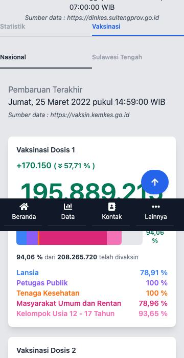
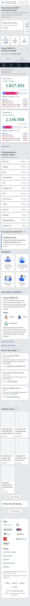

# Legacy vs new

Left: the owner's old site, rendered from its compiled bundle with live data (`docs/legacy-screens/`, harness in `docs/legacy-screens/harness/`).
Right: this branch (`docs/new-screens/`, light; dark and 360 px versions sit next to each file as `-dark` and `-360`).
The old site had no dark mode. Dates differ a little: the old mock ended on 14 January 2024 (zero padding), the new site stops on the last day with real counts.

### 1. Case cards (acceptance 1)

Same card: white, rounded, big shadow, category name in capitals in its colour, two halves (Sulawesi Tengah, Indonesia), figure, round coloured chip with the double chevron and the change. Added: a date under each half, a text alternative on the chevron, "tidak tersedia" instead of 0 when a number is missing. Dark: `data-cards-1280-dark.jpg`.

| Legacy (owner's site) | New |
|---|---|
|  |  |
|  |  |

### 2. Vaccine cards (acceptance 1)

Dose card with the change, the big figure, the five-segment bar (Lansia blue, Petugas Publik purple, Tenaga Kesehatan orange, Masyarakat Umum dan Rentan pink-600, Usia 12-17 pink-400), "x dari y telah divaksin" and the five group lines. The Vaksin page adds the target tiles: `vaksin-cards-1280-light.jpg`. The home page figures are whole pages; the legacy home figure is a crop.

| Legacy (owner's site) | New |
|---|---|
|  |  |
|  |  |

### 3. Choropleth, Sulawesi Tengah and Indonesia (acceptance 2)

The new map block shows the province map (Indonesia) and, on the Sulawesi Tengah page, the kabupaten/kota map under it, with legend, tooltip (hover and focus), table, +/- and reset. Titik mode = proportional marks with role shapes. 360 px: `data-map-sebaran-360-light.jpg`.

| Legacy (owner's site) | New |
|---|---|
|  |  |
|  |  |
|  |  |

### 4. Zoomable charts (acceptance 6)

Daily bars with the 7-day average and the cumulative line. Zoom: drag to select, Ctrl/Cmd + wheel or pinch, Shift + drag or the pan buttons, `+` `-` `0` and Shift + arrows, Reset zoom, table view.

| Legacy (owner's site) | New |
|---|---|
|  |  |
|  |  |

### 5. Rt chart with the 95 % bounds (acceptance 5)

Left: legacy Rt line with the band and its wheel-zoomed state. Right: line, shaded band, upper (solid) and lower (dashed) bound lines labelled in the chart, legend and tooltip, Rt = 1, gaps for missing days, clipped points ringed with their numbers and listed, "Skala penuh".

| Legacy (owner's site) | New |
|---|---|
|  |  |
|  |  |

### 6. Levels (acceptance 3 and 9): Nasional, Provinsi, Kabupaten/Kota

The legacy site picked the area per chart (Sulawesi Tengah or Indonesia, plus kabupaten). The level switch is now one control for cards, map and charts.

| Legacy (owner's site) | New |
|---|---|
|  |  |
|  |  |
|  |  |

### 7. Home

| Legacy (owner's site) | New |
|---|---|
|  |  |
|  |  |

## Colours (acceptance 4)

| Category | Legacy class | Hex | Used in |
|---|---|---|---|
| Positif | red-800 | `#991b1b` | card name, chip, chart, map ramp, legend |
| Dirawat | blue-600 | `#2563eb` | same |
| Sembuh | green-500 | `#10b981` | chip, chart, map ramp start; text uses `#047857` (legacy green-700, used by the old vaccine figures) |
| Meninggal | orange-500 | `#f97316` | chip, chart, map ramp start; text uses `#c2410c` |

Text in green and orange on white would not reach WCAG AA with the exact hex (2.54 and 2.80 to 1); the card text uses the next darker step of the same hue,
fills and marks use the exact hex. Dark mode moves green and orange one step darker (`#059669`, `#ea580c`) so the dataviz lightness band passes.

`node validate_palette.js "#991b1b,#2563eb,#10b981,#f97316" --mode light --surface "#ffffff"`: all checks pass; warning: contrast of `#10b981` (2.54) and
`#f97316` (2.80) against white is under 3:1 ("relief required"): the relief is the word, the chip chevron, the printed number and the table view.
CVD worst adjacent pair deutan 11.5 (pass). Dark (`#ef4444,#3b82f6,#059669,#ea580c` on `#1f2937`): all pass, CVD worst pair 10.1 (protan), tritan 5.7 reported.
Colour is never the only cue: category word on every card, role mark shapes (square, triangle, diamond, bars) on charts and legends, numbers printed on map areas, line forms.
